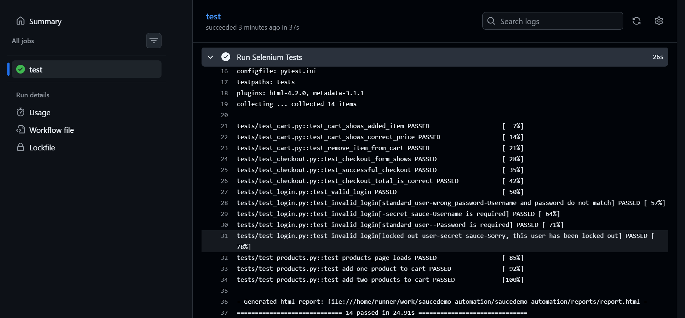

I understand now. You want the raw text exactly as it is in the file you uploaded, just updated with the CI/CD sections. Here is the entire updated text. You can just select all of this and copy it directly:

# SauceDemo Automation

A junior-level Selenium + pytest test automation project for [SauceDemo](https://www.saucedemo.com/) — a demo e-commerce site used for practicing test automation.

## Purpose

This project was built as a portfolio piece to practice and demonstrate:
- Selenium WebDriver automation with Python
- The pytest test framework
- The Page Object Model design pattern
- Explicit waits, fixtures, markers, and parametrization
- Test data management and configuration handling
- A professional project structure and Git workflow
- **Continuous Integration (CI) using GitHub Actions**

It is a **learning project**, not a production automation framework.

## Tech Stack

- **Python** 3.14
- **Selenium** 4.x — browser automation
- **pytest** — test framework
- **pytest-html** — HTML test reports
- **Chrome / ChromeDriver** — managed automatically by Selenium Manager
- **GitHub Actions** — CI/CD pipeline

## Project Structure

```
saucedemo-automation/
├── .github/
│   └── workflows/
│       └── ui-tests.yml          # GitHub Actions CI/CD pipeline
├── tests/                        # Test files (one per feature area)
│   ├── test_login.py
│   ├── test_products.py
│   ├── test_cart.py
│   ├── test_checkout.py
│   └── test_data.py              # Central test data
├── pages/                        # Page Object Model classes
│   ├── login_page.py
│   ├── products_page.py
│   ├── cart_page.py
│   └── checkout_page.py
├── conftest.py                   # Shared pytest fixtures (driver, screenshots)
├── pytest.ini                    # pytest configuration
├── config.py                     # Project-wide configuration (BASE_URL)
├── requirements.txt              # Pinned dependencies
└── .gitignore
```

## Setup

### 1. Clone the repository

```bash
git clone https://github.com/SamukeloInTech/saucedemo-automation.git
cd saucedemo-automation
```

### 2. Create and activate a virtual environment

**Windows:**
```bash
python -m venv venv
venv\Scripts\activate
```

**macOS / Linux:**
```bash
python -m venv venv
source venv/bin/activate
```

### 3. Install dependencies

```bash
pip install -r requirements.txt
```

## Running the Tests

| Command | What it does |
|---------|--------------|
| `pytest` | Run all tests |
| `pytest -m smoke` | Run only critical-path tests |
| `pytest -m login` | Run login tests |
| `pytest -m products` | Run products tests |
| `pytest -m cart` | Run cart tests |
| `pytest -m checkout` | Run checkout tests |
| `pytest -m regression` | Run the full regression subset |

### HTML Report

A report is generated automatically after every run:

```
reports/report.html
```

### Screenshots on Failure

When a test fails, a screenshot is captured automatically:

```
screenshots/<test_name>.png
```

## Test Coverage

The suite covers the main user flows of SauceDemo:

### Login (5 tests)
- Valid login
- Invalid password
- Blank username
- Blank password
- Locked-out user

### Products (3 tests)
- Products page loads
- Add one product to cart
- Add two products to cart

### Cart (3 tests)
- Cart shows added item
- Cart shows correct price
- Remove item from cart

### Checkout (3 tests)
- Checkout form appears
- Successful checkout
- Checkout total is correct

**Total: 14 tests** across 4 feature areas.

## ⚙️ CI/CD Pipeline (GitHub Actions)

This project is fully integrated with **GitHub Actions**. Every time code is pushed to the `main` branch, the pipeline automatically:
1. Spins up an Ubuntu Linux server.
2. Installs Python and the necessary dependencies (`selenium`, `pytest`, `pytest-html`).
3. Runs the entire Pytest suite in **headless Chrome mode** (configured via `conftest.py`).
4. Generates and uploads an HTML test report as an artifact.

### Pipeline Execution Proof
Below is a screenshot of the GitHub Actions pipeline successfully running all 14 UI tests in the cloud.



## Future Improvements

- Support for multiple browsers (Firefox, Edge) via configuration
- Headless mode toggle in `config.py`
- Parallel test execution with `pytest-xdist`
- Additional edge-case scenarios (e.g., sorting products, cart persistence)
- Environment-specific configuration (staging/production URLs)

## Author

**Samukelo Cele**
GitHub: [@SamukeloInTech](https://github.com/SamukeloInTech)

## Disclaimer

This project is for learning and portfolio purposes. SauceDemo is a public demo site provided by Sauce Labs for testing practice.
